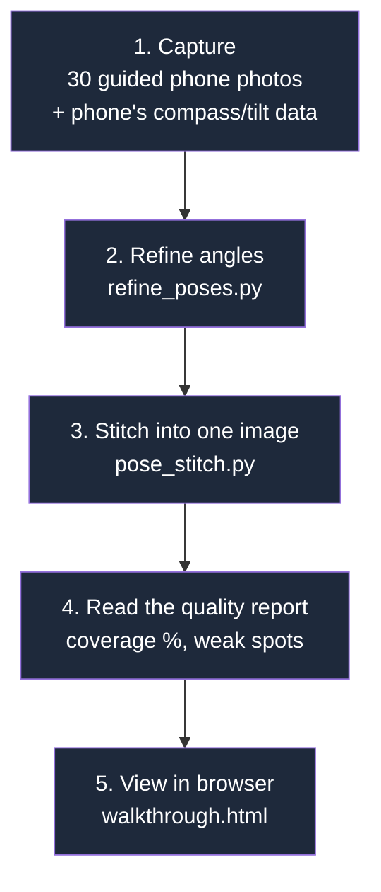

# PanoStitch

PanoStitch turns 30 phone photos of a room into one 360° panorama picture, and shows it in a
web page you can drag around and explore like a virtual tour. This document explains what the
project does, what we improved, and what still needs work — in plain English.

> **Panorama** = a single wide picture made by joining several overlapping photos together.
> **360° panorama** = a panorama that wraps all the way around, so you can look in every
> direction (up, down, left, right) from one spot, the way a photo sphere works.

---

## 1. How it works, step by step



| Step | What happens | In plain English |
| --- | --- | --- |
| 1. Capture | The phone app takes 30 photos in a guided pattern (level ring, up ring, down ring, straight up, straight down) and records which way the phone was pointing for each one. | Like taking a full circle of photos, plus some looking up and down, so nothing is missed. |
| 2. Refine angles | `refine_poses.py` looks for matching details between overlapping photos and nudges each photo's recorded angle to line up better. | The phone's compass isn't perfectly accurate (off by about 8° on average). This step corrects that using the photos themselves. |
| 3. Stitch | `pose_stitch.py` wraps every photo onto an imaginary sphere at its (corrected) angle, then blends the overlapping edges together into one smooth image. | Think of it like wrapping photographs around the inside of a ball, lining up the edges, and smoothing the joins so they're invisible. |
| 4. Quality report | The script prints how much of the sphere is covered, and which areas (ceiling, floor, walls) have weak or strong overlap. | A health check — tells you if any angle was missed or badly covered before you trust the result. |
| 5. View | `walkthrough.html` opens that image in a 360° viewer (a library called **Pannellum**) in your browser, where you can click-drag to look around. | Turns the flat output image into an interactive "look around the room" experience. |

---

## 2. What we improved

### Before and after

The **before** image used a different, older method (`cv2.Stitcher_create()`, OpenCV's
built-in panorama tool) which only stitched a flat strip of photos — it could not cover a full
sphere and had to be stretched to fit the 360° viewer, which distorted the room.

The **after** image uses the new pose-guided method (the one described above), shown as a true
full sphere.

| Before (old method, stretched to fit) | After (new method, true 360°) |
| --- | --- |
|  |  |

### What changed, in plain English

| Improvement | What it means |
| --- | --- |
| **Fixed a duplicate viewer bug** | The web page was accidentally building the 360° viewer twice on top of itself. Removed the extra copy. |
| **Switched to the real 360° image** | The viewer now shows the full sphere image instead of a stretched, cropped preview, so the room looks the correct shape. |
| **Coverage report** | The stitching script now tells you, after it runs, what percentage of the sphere has a photo, and which areas (ceiling, floor, walls) are weakly covered. |
| **Adjustable output size** | You can now ask for a bigger, sharper final image (`--width 8192`) instead of being stuck with one fixed size. A bigger image takes longer to make and uses more computer memory. |
| **Gap filling** | If any small part of the sphere has no photo at all, the script now paints in a smooth guess for that area (a technique called **inpainting** — like Photoshop's "content-aware fill") instead of just smearing the nearest edge pixel across it. |
| **Colour matching between photos** | Each photo can come out slightly brighter/darker or a different colour tint than its neighbour (different auto-exposure per shot). The script now evens this out per colour channel (red, green, blue separately) so joins are less visible. |
| **Smarter photo priority at seams** | Where two photos overlap, the sharper, steadier one (least blurry, least camera-shake) now "wins" that overlapping area, instead of picking arbitrarily. |
| **Auto-rotate & compass in the viewer** | The web viewer now gently spins to show off the room when idle, and shows a compass, like real estate virtual-tour sites. |
| **Clearer error messages** | If the panorama image fails to load, the page now says so clearly instead of just hanging on "Loading...". |

---

## 3. Known issues (what still isn't perfect)

| Issue | What you'll see | Why it happens |
| --- | --- | --- |
| Ceiling "ghosting" | Doubled or smeared lines where ceiling photos join (see image below). | The phone moves slightly between shots (called **parallax** — near objects shift more than far ones when the camera moves), and the current method doesn't pick smart, content-aware joins yet. |
| Photographer visible at the floor | Feet/legs show up at the very bottom of the sphere. | The straight-down photo naturally includes whoever is holding the phone. |
| Weak floor coverage | The floor area has thinner overlap between photos than the walls. | Only one "straight down" photo is taken, so there's less double-coverage there to blend from. |
| Single room only | No way yet to click through to another room. | The multi-room "walkthrough" (linking several panoramas together) hasn't been built yet — only single-room panoramas exist so far. |
| Needs internet to view | The viewer won't work with no internet connection. | It loads its 360°-viewing code (Pannellum) from an online source rather than storing it locally. |

**Ceiling ghosting close-up** (top strip of the panorama):


**Floor area close-up** (bottom strip of the panorama — note the visible feet):


---

## 4. How to run it yourself

```bash
# 1. Turn on the Python environment (has all the needed libraries pre-installed)
source .venv/bin/activate

# 2. (Recommended) Correct the camera angles using the photos themselves
python refine_poses.py

# 3. Stitch the 30 photos into one panorama (takes about 17 seconds)
python pose_stitch.py output_images/pano.jpg

#    For a bigger, sharper image (takes about 90 seconds, needs ~8GB of memory):
python pose_stitch.py output_images/pano_8k.jpg --width 8192 --scale 1.0

# 4. Start a local web server so the browser is allowed to load the image file
python -m http.server 8000

# 5. Open this in your browser:
#    http://localhost:8000/walkthrough.html
#    Add ?img=output_images/pano_8k.jpg to the URL to view a different image.
```

---

## 5. Glossary — technical words used above

| Word | Plain-English meaning |
| --- | --- |
| **Panorama** | One wide picture made by joining several overlapping photos. |
| **Equirectangular / 360°** | A panorama stretched flat (like a world map) that represents a full sphere view — top, bottom, and all the way around. |
| **Stitching** | The process of joining overlapping photos into one combined image. |
| **Seam** | The invisible (ideally) line where two photos are joined together. |
| **Blending** | Smoothly fading one photo into the next across a seam, so the join isn't an obvious hard edge. |
| **Exposure / exposure gain** | How bright or dark a photo came out. "Gain" is the brightness adjustment applied to a photo to match its neighbours. |
| **Parallax** | The way near objects appear to shift more than far objects when the camera moves slightly — the main cause of ghosting when stitching handheld photos. |
| **Pose / quaternion** | The direction the phone was pointing when it took a photo (which way is "up," "forward," etc.), recorded as a set of numbers by the phone's internal sensors. |
| **Feature matching** | Automatically finding the same physical detail (a corner, a pattern) in two different photos, used to line them up precisely. |
| **Inpainting** | Automatically painting in a believable guess for a small missing area of an image, based on what's around it. |
| **Nadir / zenith** | Nadir = straight down (the floor). Zenith = straight up (the ceiling). |
| **Coverage** | What percentage of the full 360° sphere actually has photo data in it (ideally 100%). |
| **Pannellum** | The free, open-source library used to display and let you drag-look-around a 360° image in a web browser. |

---

## 6. Future direction: multiple rooms

The long-term goal is a full walkthrough: take panoramas from several rooms or viewpoints and
let a viewer click from one into the next, the way real-estate virtual tours work. This needs:

1. A panorama for each room (the part that already works).
2. A way to mark a clickable "doorway" hotspot in one panorama that jumps to the next room's panorama.
3. A viewer that can hold multiple panoramas and switch between them smoothly.

This is not built yet — only the single-room panorama pipeline above is working today.
